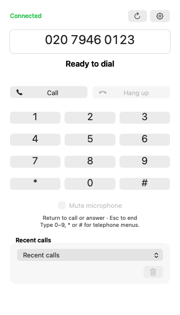
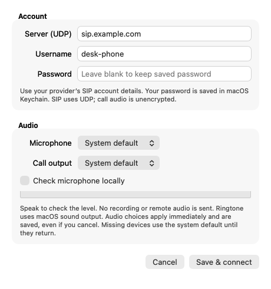

# Simple Dialler

Simple Dialler is a small native macOS app for making and answering SIP telephone calls. It is designed for people who prefer to enter numbers with a keyboard.

I wanted a simple phone app for my desk. The alternatives I tried felt overly complicated for what I needed, so I built my own pared-back version: type a number, make a call and get on with the day.

## Screenshots

| Dialler | Account setup |
| --- | --- |
|  |  |

The screenshots use offline example details. The native controls follow the macOS light or dark appearance. Account and audio controls are grouped in Settings; recents stay available below the dial pad.

## Features

- Type or paste a telephone number and press **Enter** to call.
- Press **Enter** to answer an incoming call, or **Escape** to reject or end a call.
- During a call, press **0–9**, **\*** or **#** to send keypad tones. The on-screen keypad is also available.
- Mute the microphone from the main window.
- Open the main window, settings or quit from the phone icon in the menu bar.
- Save SIP account details in the app's settings. The password is stored in macOS Keychain.
- Keep the last 20 distinct outgoing numbers, newest first, per SIP account. Choose a recent number with the mouse or keyboard, then press **Enter** to call. Accepted call attempts are retained even if the other person does not answer; microphone-denied and immediately failed attempts are not.
- Retain up to 20 incoming call outcomes separately, including missed and locally rejected calls. A menu-bar count highlights unseen missed calls. Choose a missed call to fill its callback number, use **Mark seen** to clear the count, or **Clear recents** to delete the current account's local history. Caller identities without a telephone number cannot be called back.
- See elapsed connected-call time, including while muted. Ringing time is excluded.
- See readable common SIP errors with the original code and use **Reconnect** to reconnect with the saved Keychain password.
- Select microphone and call-output devices in **Settings…**, and check the microphone input level locally without placing a call. The ringtone follows the macOS sound output. Audio selection takes effect immediately and is saved across reconnects and relaunches; missing devices fall back to system defaults while idle, and the saved choice is restored when it returns.
- Use one call at a time. The app does not include contacts, video, recording or voicemail.

Closing the main window leaves Simple Dialler running and registered. Use the menu-bar icon to reopen the window or choose **Quit Simple Dialler** to disconnect and quit. If a call is active, quitting asks before ending it.

The app uses UDP for SIP signalling and unencrypted RTP for call audio. It does not provide TLS or SRTP. Use it on a network you trust and check that this connection is suitable for your SIP provider.

## Download

Download the Apple Silicon app ZIP from [GitHub Releases](https://github.com/birdseeed/simple-dialler/releases/latest), unzip it and move **Simple Dialler.app** to Applications. The matching complete source archive and SHA-256 checksums are on the same release.

The app is ad-hoc signed and is not notarised by Apple. macOS may block the first launch; after trying to open it, use **System Settings → Privacy & Security → Open Anyway** if you choose to trust this download.

## Requirements

- An Apple Silicon Mac running macOS 27 or later.
- A SIP account and microphone access.

The downloaded app includes its dependencies and does not require Homebrew or developer tools. Building from source additionally requires Xcode Command Line Tools. See [the dependency rebuild instructions](docs/RELEASING.md) for the pinned release build, or use the Homebrew development build below.

## Build from source

For a development build, install the Command Line Tools and Homebrew, then run:

```sh
brew install pjproject openssl@4
./build.sh
./install.sh
```

The script runs number/account validation, account-scoped history, callback-number, timer-formatting and recovery-policy checks, three offline SIP engine creation and teardown cycles, and deterministic callback regression checks for call races, atomic account transitions, incoming outcomes and monotonic timing. It also exercises repeated local audio-port cleanup with a null sound clock, plus an offline AppKit harness for microphone-stop actions, saved-device fallback and settings layout. These checks do not register an account, place a call, read Keychain passwords or open physical audio devices. The lifecycle checks use a temporary local UDP socket and do not send SIP traffic.

`build.sh` builds and ad-hoc signs `Simple Dialler.app` in the local developer build folder under your Library. `install.sh` verifies the built app and installs it in `~/Applications`. Quit Simple Dialler and end any call before installing; the installer stops safely if the app is still running. You can choose another build output folder by setting `SIMPLE_DIALLER_BUILD_DIR` before running either script.

On first launch, the app checks for `~/Library/Zoiper5/Config.xml`. If it finds a compatible account, it imports only the SIP server and username. It ignores Zoiper's encrypted password and does not import call history or contact the provider as part of the import. You can review or change the account in **Settings…** from the menu-bar icon. Enter your SIP server, username and password, then choose **Save & connect**. For example, a Voipfone user may use `sip.voipfone.net` as the server. Use the account details supplied by your own provider. The password is saved in macOS Keychain; the server, username and local call history are saved in the app's preferences. Call history is not encrypted by this app. It is separate for each server/username combination and can be cleared from the main window.

The app is ad-hoc signed and is not notarised by Apple. macOS may show a security prompt when you first open it.

On first use, macOS asks for microphone access when you place or answer a call, or enable the local microphone check. The check sends input to a local discard sink, does not play it through the speakers, and stops when disabled, when Settings closes, or when a call arrives or starts. If access was denied, enable it under **System Settings → Privacy & Security → Microphone**. To start the app when you sign in, add it under **System Settings → General → Login Items**.

## Testing notes

Automated checks cover number/account validation, local-history retention and account isolation, missed/rejected outcomes retained between UI polls, callback parsing, duration formatting and monotonic timing, deferred/rate-limited recovery, offline SIP engine lifecycle, atomic account-transition admission and incoming/outgoing callback races. Audio-port lifetime is tested against the real conference bridge with a null sound clock; physical capture is replaced for this test. The AppKit harness constructs the UI with fixture settings without invoking app launch or account connection. They do not establish that a live SIP service or physical audio device works.

To regenerate the example screenshots, run `SIMPLE_DIALLER_UI_SCREENSHOTS="$PWD/docs/screenshots" ./build.sh`. The offline AppKit harness renders only its own fixture windows in light and dark appearances; it does not launch the dialler, read Keychain credentials, register an account or open a microphone.

After wake or a network-path change the app waits for the network to settle, then requests registration refresh. Recovery waits until the current call ends and coalesces repeated notifications. The provider's registration retry remains enabled. Reconnect performs a full account reconnect; it is disabled during calls. This cannot preserve a call across a network outage.

Device discovery refreshes while idle and remaps the selected device by name; a removed device falls back to the system default. Identically named devices cannot be distinguished. Device changes during a connected call, Bluetooth routing, actual microphone levels, network-loss recovery and sleep/wake still need hands-on validation. The completion-event buffer retains the most recent 32 incoming outcomes between polls; normal polling drains it every 100 ms.

Manual testing has covered incoming and outgoing calls with Voipfone, audio in both directions, and the provider's sound test. This is limited testing with that provider. These earlier live checks predate the new recents, recovery, timer and audio controls. Telephone menu tones (DTMF), the new controls and sleep/wake behaviour have not been verified live in this change.

## Source and licences

Copyright © 2026 Andy Bridson.

The Simple Dialler source is offered under **GNU GPL version 3 or, at your option, any later version**. See [LICENSE](LICENSE). Third-party components keep their own licences; see [THIRD_PARTY_NOTICES.md](THIRD_PARTY_NOTICES.md) and the retained licence files in `Licenses/`.

Binary releases include the matching complete source archive, build recipes and dependency notices. See [rebuild and release instructions](docs/RELEASING.md). The release build excludes G.722.1 and iLBC; standard G.711 PCMU/PCMA telephone codecs remain enabled.
