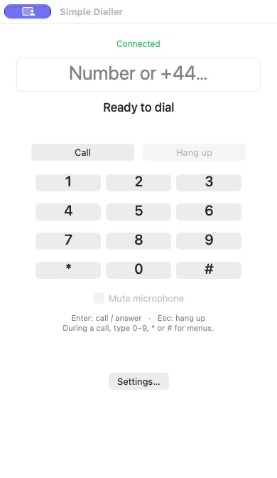
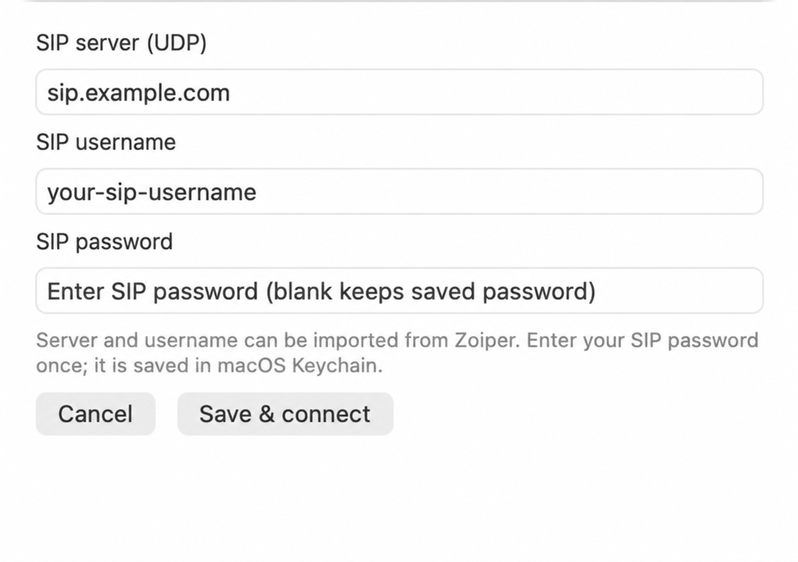

# Simple Dialler

Simple Dialler is a small native macOS app for making and answering SIP telephone calls. It is designed for people who prefer to enter numbers with a keyboard.

## Screenshots

| Dialler | Account setup |
| --- | --- |
|  |  |

The account setup screenshot uses example details.

## Features

- Type or paste a telephone number and press **Enter** to call.
- Press **Enter** to answer an incoming call, or **Escape** to reject or end a call.
- During a call, press **0–9**, **\*** or **#** to send keypad tones. The on-screen keypad is also available.
- Mute the microphone from the main window.
- Open the main window, settings or quit from the phone icon in the menu bar.
- Save SIP account details in the app's settings. The password is stored in macOS Keychain.
- Use one call at a time. The app does not include call history, contacts, video, recording or voicemail.

Closing the main window leaves Simple Dialler running and registered. Use the menu-bar icon to reopen the window or choose **Quit Simple Dialler** to disconnect and quit. If a call is active, quitting asks before ending it.

The app uses UDP for SIP signalling and unencrypted RTP for call audio. It does not provide TLS or SRTP. Use it on a network you trust and check that this connection is suitable for your SIP provider.

## Download

Download the Apple Silicon app ZIP from [GitHub Releases](https://github.com/birdseeed/simple-dialler/releases/latest), unzip it and move **Simple Dialler.app** to Applications. The matching complete source archive and SHA-256 checksums are on the same release.

The app is ad-hoc signed and is not notarised by Apple. macOS may block the first launch; after trying to open it, use **System Settings → Privacy & Security → Open Anyway** if you choose to trust this download.

## Requirements

- An Apple Silicon Mac running macOS 27 or later.
- A SIP account and microphone access.

The downloaded app includes its dependencies and does not require Homebrew or developer tools. Building from source additionally requires Xcode Command Line Tools. See [the dependency rebuild instructions](docs/RELEASING.md) for the pinned release build, or use the Homebrew development build below.

## Build from source

For a development build, install the Command Line Tools and Homebrew, then run:

```sh
brew install pjproject openssl@4
./build.sh
./install.sh
```

The script runs 36 dial and account validation checks, three offline SIP engine creation and teardown cycles, and a callback regression check for an incoming-call race. These checks do not register an account or place a call. The lifecycle checks use a temporary local UDP socket and do not send SIP traffic.

`build.sh` builds and ad-hoc signs `Simple Dialler.app` in the local developer build folder under your Library. `install.sh` verifies the built app and installs it in `~/Applications`. Quit Simple Dialler and end any call before installing; the installer stops safely if the app is still running. You can choose another build output folder by setting `SIMPLE_DIALLER_BUILD_DIR` before running either script.

On first launch, the app checks for `~/Library/Zoiper5/Config.xml`. If it finds a compatible account, it imports only the SIP server and username. It ignores Zoiper's encrypted password and does not import call history or contact the provider as part of the import. You can review or change the account in **Settings…** from the menu-bar icon. Enter your SIP server, username and password, then choose **Save & connect**. For example, a Voipfone user may use `sip.voipfone.net` as the server. Use the account details supplied by your own provider. The password is saved in macOS Keychain; the server and username are saved in the app's preferences.

The app is ad-hoc signed and is not notarised by Apple. macOS may show a security prompt when you first open it.

On first use, macOS asks for microphone access when you place or answer a call. If access was denied, enable it under **System Settings → Privacy & Security → Microphone**. To start the app when you sign in, add it under **System Settings → General → Login Items**.

## Testing notes

Automated checks cover number and account validation, offline SIP engine lifecycle, and one incoming/outgoing callback race. They do not establish that a live SIP service works.

Manual testing has covered incoming and outgoing calls with Voipfone, audio in both directions, and the provider's sound test. This is limited testing with that provider. Telephone menu tones (DTMF) and sleep/wake behaviour have not been verified.

## Source and licences

Copyright © 2026 Andy Bridson.

The Simple Dialler source is offered under **GNU GPL version 3 or, at your option, any later version**. See [LICENSE](LICENSE). Third-party components keep their own licences; see [THIRD_PARTY_NOTICES.md](THIRD_PARTY_NOTICES.md) and the retained licence files in `Licenses/`.

Binary releases include the matching complete source archive, build recipes and dependency notices. See [rebuild and release instructions](docs/RELEASING.md). The release build excludes G.722.1 and iLBC; standard G.711 PCMU/PCMA telephone codecs remain enabled.
